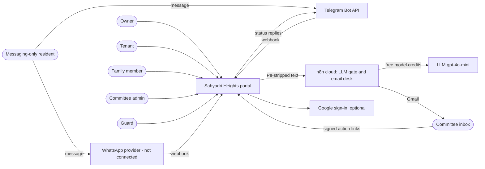
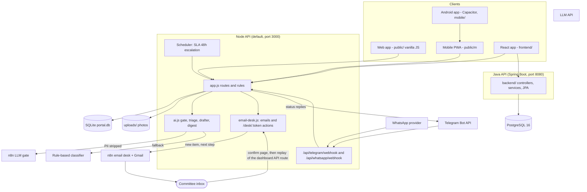
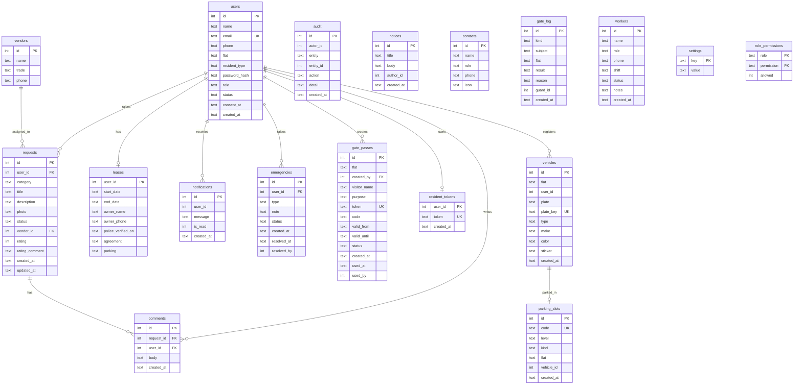
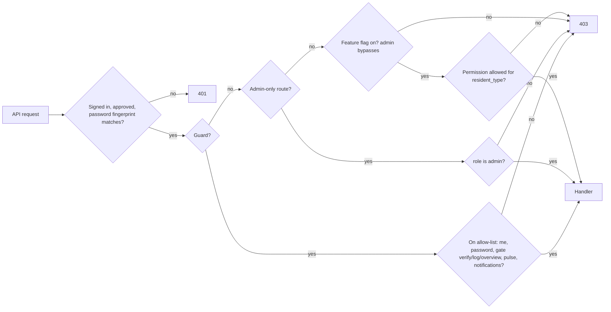
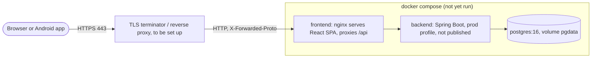

# Architecture

Decision record: [ADR 0001, move to Java (Spring Boot) and React side by side](adr-0001-java-react.md). The API contract is frozen: both backends expose the same URLs and JSON, and `public/api.js` documents it. Parts marked **planned** are not built yet. Updated 2026-11-14: Telegram intake, the n8n LLM gate and the committee email desk are built, tested and live; WhatsApp delivery is built but not connected.

## 1. System context

## 2. Containers and components

Notifications today are rows in `notifications` read by polling (`/api/pulse`, `/api/notifications`).

## 3. Data model (from `db.js`)

Added for the AI workflows (in `db.js` as additive columns): `requests.source` (app, whatsapp, telegram), AI suggestion fields (`ai_category`, `ai_priority`, `ai_summary`, `ai_vendor_id`, `ai_action`, `ai_source`, `ai_confidence`), `requests.escalated_at`, `users.telegram_id`, and a message log `whatsapp_messages` (with a `channel` column) for both chat channels. The email desk keeps no table: its links are signed tokens and its sends are written to `audit` (`emailed_committee`, `email_action`). Foreign-key links shown for audit, notices and gate_log are logical (columns exist, no declared FK).

## 4. Access control
Roles: `admin` (committee), `resident` with `resident_type` owner, tenant or family, and `guard`. The permission matrix applies to the three resident types and is editable by the committee (`/api/admin/access`). Defaults come from `db.js`: owner has all nine, tenant lacks `household.manage`, family lacks `household.manage`, `lease.view`, `vehicle.manage`. Committee has all permissions; guards use an allow-list.

| Permission | Owner | Tenant | Family | Committee | Guard |
| --- | --- | --- | --- | --- | --- |
| request.create | yes | yes | yes | yes | no |
| emergency.raise | yes | yes | yes | yes | no |
| gate.pass | yes | yes | yes | yes | no |
| household.manage | yes | no | no | yes | no |
| notice.read | yes | yes | yes | yes | no |
| contacts.read | yes | yes | yes | yes | no |
| lease.view | yes | yes | no | yes | no |
| vehicle.manage | yes | yes | no | yes | no |
| parking.view | yes | yes | yes | yes | no |

Feature flags: emergency, gate, contacts, notices, parking. Admin-only examples: assign and status of requests, vendors, notices post, leases, users, settings, audit, export, guards, workers, parking edits.

## 5. Request lifecycle

```mermaid
stateDiagram-v2
  [*] --> open: resident or WhatsApp creates request
  open --> assigned: committee assigns vendor (dashboard or email; AI suggestion confirmed by human)
  assigned --> in_progress: committee approves start (dashboard or email)
  in_progress --> closed: committee approves done (dashboard or email)
  closed --> closed: rated once by requester or owner
  closed --> [*]
```

Forward-only; a vendor is required to progress; a closed request cannot be re-moved. In the UI, closed and unrated shows as "Resolved, awaiting rating". Skipping straight from open to closed is blocked by the vendor rule. Overdue (older than 48h, not closed) requests are escalated once automatically (every 10 minutes check), notified and audited. When nobody is on the dashboard, each stage change made from email sends the next step by email until the request is resolved.

## 6. Deployment

`docker-compose.yml` and `docs/deploy.md` exist but the Compose stack has not been run on a machine with Docker. CI (`.github/workflows/ci.yml`) runs on every pull request and is green: Node tests, Java on H2, Java on PostgreSQL 16 with a packaged boot, React, and a Docker image build. The live deployment is the Node app on the Render free plan (https://sahyadri-heights.onrender.com), with n8n cloud for the LLM gate and the email desk.

## 7. Design note
**Why a Node MVP first.** The brief rewards a working product early. Node with Express and `node:sqlite` has no build step or native dependency, so the five core requirements and their tests existed in the first session. Every rule (role checks, forward-only lifecycle, audit on each change) was captured as an executable test.

**Why then Java and React.** A society portal is long-lived and handed between people; Spring Boot and React are mainstream, widely staffed and have mature tooling (ADR 0001). The strangler approach reused the Node tests as the behavioural spec, and the Java suite (79 tests) and React suite (65 tests) prove parity phase by phase. The Node app stays the system of record until cutover.

**Why hosted PostgreSQL.** SQLite is a single file on one server: fine for a demo, weak for backups, concurrent writers and managed failover. A hosted PostgreSQL gives backups, point-in-time recovery and TLS connections. `scripts/export-sqlite-to-postgres.js` moves existing data. This is the target, not yet the running state.

**How AI is bounded.** (1) AI code lives in one module (`ai.js`), called only from the request-creation path, the scheduler and the notice drafter. (2) PII (names, phones, emails, flat numbers) is stripped before any model call, so the model sees only the problem text. (3) Output is validated against a fixed category list and priority scale; invalid output falls back to a rule-based classifier, so the portal works with the model off. (4) AI writes suggestions, never state: assignments and notices need a committee member's click, and both the suggestion and the confirmation are audited. (5) Webhooks check a shared secret (provider signature checks and rate limiting are still to do).

**Why the email desk replays the API.** Email actions could have had their own code path, but that would duplicate the rules. Instead each button opens a confirm page, and confirming calls the same API route the dashboard uses, as the committee admin, over loopback with an in-process key. One set of rules, one audit trail, one set of tests. Links are HMAC-signed per item and expire in 7 days; a GET never changes state, so mail scanners that open links cannot act.
