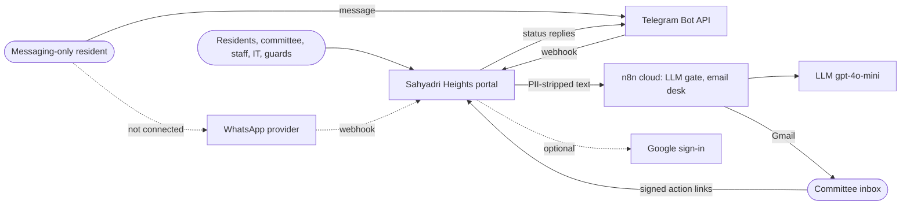
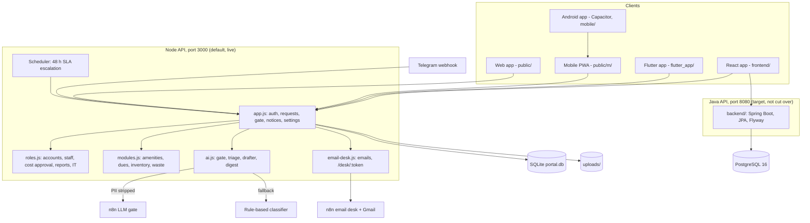
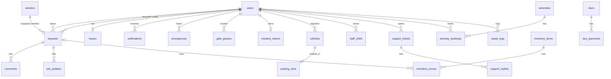
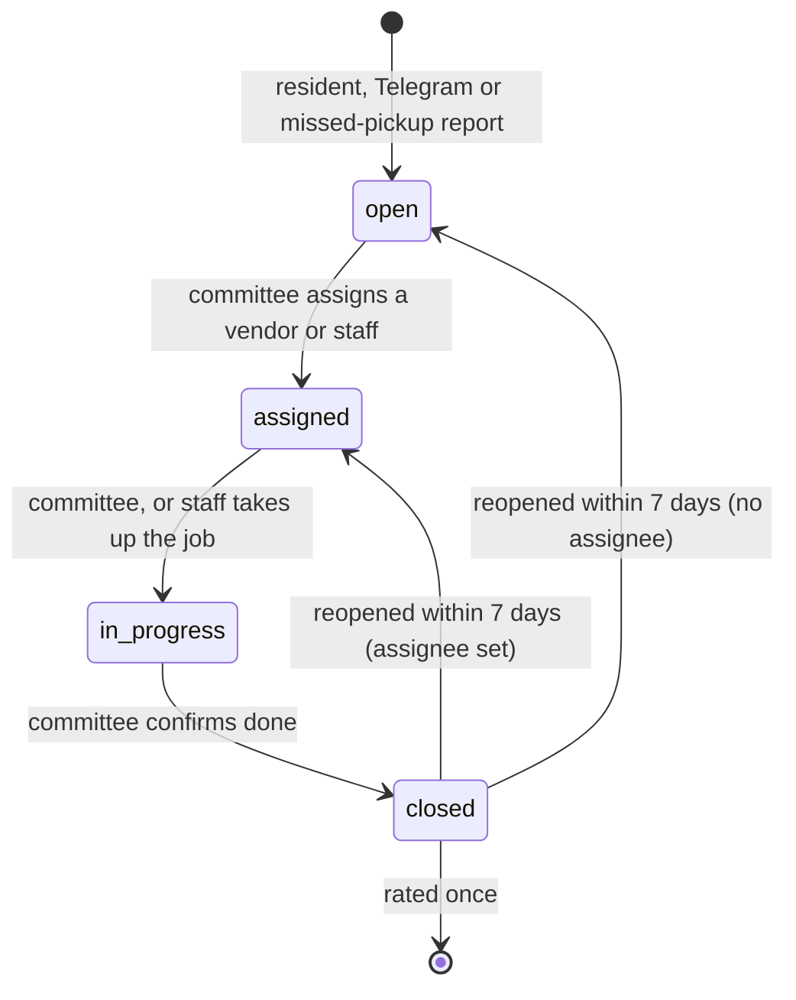
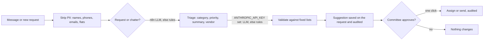

# Architecture

Related: [product and technology architecture](product-and-technology-architecture.md) (modules, tech per tier), [ADR 0001](adr-0001-java-react.md) (Java + React migration), [deploy.md](../deploy.md), API contracts in [roles-api.md](../roles-api.md), [modules-api.md](../modules-api.md) and `public/api.js`.

The Node app is the system of record and the live deployment. The Java + React stack uses the same API contract but is not cut over.

## 1. System context

## 2. Containers and components

In-app notifications are rows in `notifications`, read by polling (`/api/pulse`, `/api/notifications`).

## 3. Data model (`db.js`)

| Area | Tables |
| --- | --- |
| People and access | `users` (role, position, resident_type, flat, telegram_id), `leases`, `role_permissions`, `settings` |
| Requests | `requests` (status, vendor_id or assignee_id, cost fields, AI suggestion fields, source), `comments`, `job_updates`, `vendors` |
| Staff and IT | `staff_shifts`, `support_tickets`, `support_replies` |
| Communication | `notices`, `notifications`, `emergencies`, `contacts`, `whatsapp_messages` (both chat channels) |
| Gate and parking | `gate_passes`, `resident_tokens`, `gate_log`, `vehicles`, `parking_slots`, `workers` |
| Society modules | `amenities`, `amenity_bookings`, `dues`, `due_payments`, `inventory_items`, `inventory_moves`, `waste_schedule`, `waste_logs` |
| Trail | `audit` (every state change) |

Unique rules: one active booking per amenity, date and start; one bill per flat, period and title. The email desk has no table: links are signed tokens and sends are written to `audit`.

## 4. Request lifecycle

- Forward-only; an assignee is required to progress.
- A cost estimate above `approval_limit` (default Rs 10,000) blocks `in_progress` and `closed` until the head of committee approves.
- Older than 48 h and not closed: escalated once (checked every 10 minutes), notified and audited.
- Stage changes can also be made from the email desk; they replay the same API route.
- In the UI a closed, unrated request shows as "Resolved, awaiting rating".

## 5. Security
- Session cookie bound to the password hash; login rate limits; Google sign-in only for existing accounts.
- Role check on every route. Guards, staff and IT have strict route allow-lists in `auth`.
- Governance routes (settings, access rules, accounts, guards, Telegram webhook) need the head of committee or sysadmin.
- Resident rights come from the editable permission matrix (owner, tenant, family) plus feature flags (emergency, gate, contacts, notices, parking).
- Parameterised SQL only; all UI output escaped; strict CSP (`'self'`); cross-origin POST rejected.
- Every state change writes `audit`.
- Webhooks and email links: shared secret for webhooks; HMAC-signed email links that expire in 7 days, and a GET never changes state.

## 6. AI flow

AI lives in `ai.js` and only suggests. Invalid model output falls back to rules, so the portal works with no model. The notice drafter and weekly digest follow the same rule: a person sends.
