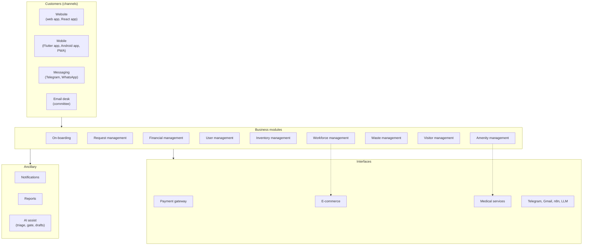
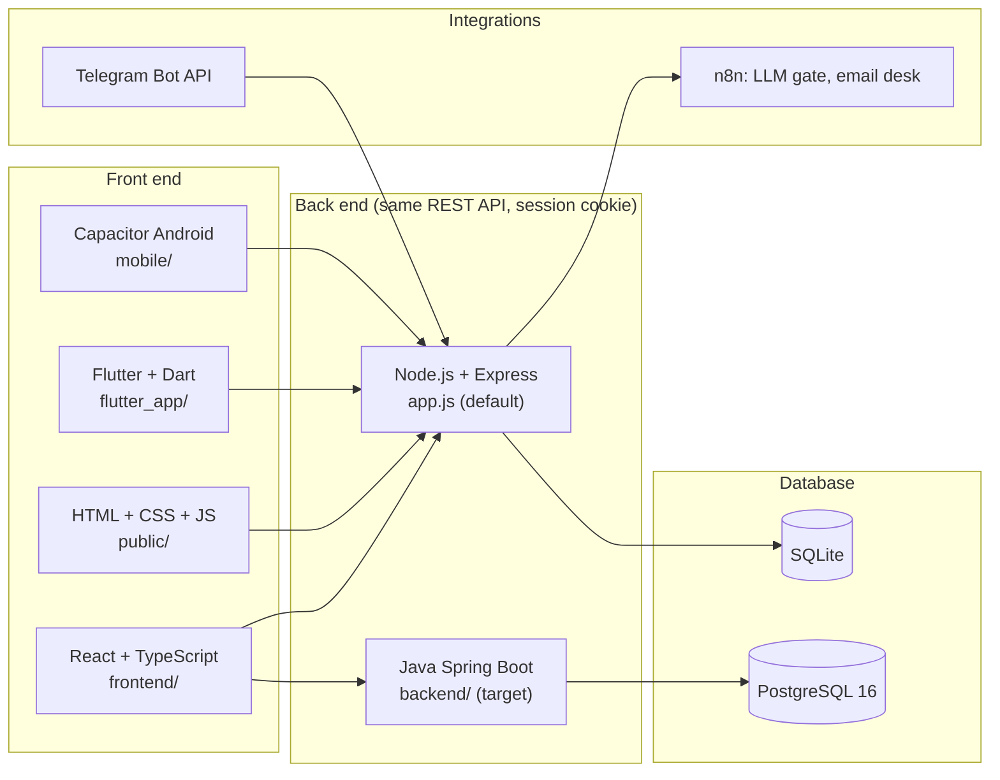
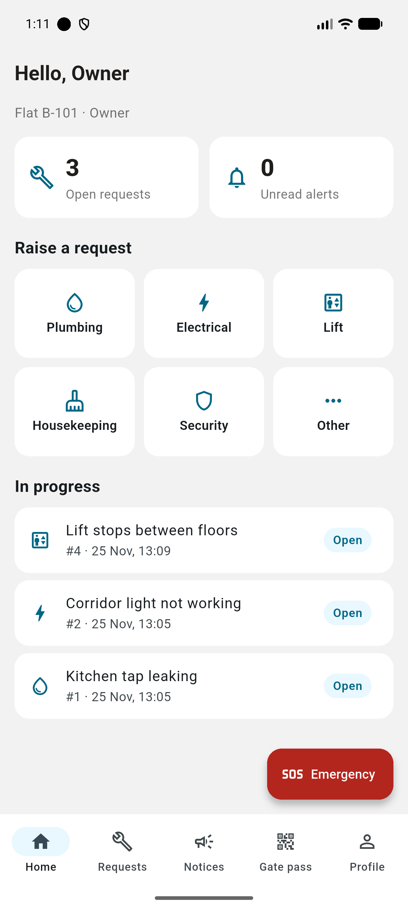

# Product architecture and technology architecture

Source: the faculty whiteboard from the class review on 2026-11-25 (photo below). The board asks for two views of the system:

1. **Product architecture**: who uses the product, which business modules it has, the supporting (ancillary) services, and the outside systems it connects to.
2. **Technology architecture**: the technology chosen for each tier (front end, back end, database).

Some words on the board are hard to read. Where we had to guess a word, the table says so.

---

## 1. Product architecture

The board draws the product as four layers, from top to bottom:

| Layer | On the board | What it means for Sahyadri Heights |
|---|---|---|
| **Customers** (channels) | Website, Mobile | How residents, the committee, staff and guards reach the product |
| **Business modules** | On-boarding, Request management, Financial management, User management, Inventory management, Workforce management, Waste management, Visitor management, Amenity management | The society's day-to-day work |
| **Ancillary** | Notifications, Reports | Services every module uses |
| **Interfaces** | Payment gateway (plus arrows out to **E-commerce** and a partner the board writes as "Medico", which we read as medical services) | Outside systems |

### Module status in our build

Built = working in the Node API and the web app today. Partial = some of it is built. Planned = not built yet.

| Module | Status | What exists today | Where |
|---|---|---|---|
| On-boarding | Built | Self-registration with consent, committee approval, owner adds family and tenants, tenant lease | `app.js` `/api/register`, `/api/household`, `/api/admin/users` |
| Request management | Built | Raise with photo, AI triage, forward-only lifecycle, vendor or staff assignment, messages, rating, reopen within 7 days, SLA escalation, Telegram and WhatsApp intake, email actions | `app.js` `/api/requests*`, `ai.js`, `email-desk.js` |
| User management | Built | Roles (resident, committee, guard, staff, IT), committee positions (member, head, admin), access matrix per resident type, suspend and remove | `app.js` `/api/admin/users`, `/api/admin/access`, `roles.js` |
| Visitor management | Built | Visitor gate passes, the resident's personal QR and NFC gate token, the guard's verify screen, gate log | `app.js` `/api/gate/*` |
| Workforce management | Partial | Vendors, staff jobs (accept, update, hand over), shifts (punch in and out), society workers register | `roles.js` `/api/staff/*`, `app.js` vendors and workers |
| Financial management | Partial | Cost estimates on requests; costs over the approval limit need the head of committee. No maintenance bills or dues yet | `roles.js` cost approval |
| Inventory management | Planned | Not built. Parking slots and vehicles are the only asset registers so far | (vehicles and parking in `app.js`) |
| Waste management | Planned | Not built. Housekeeping requests are the nearest thing | |
| Amenity management | Planned | Not built (clubhouse or hall booking) | |
| Notifications | Built | In-app notifications, Telegram replies, notice broadcast, committee email desk, emergency alerts | `app.js`, `email-desk.js` |
| Reports | Built | Monthly report, CSV export, weekly AI digest, audit trail | `roles.js` `/api/admin/reports/monthly`, `app.js` |
| Payment gateway | Planned | Not built. It would go with bills and dues (for example Razorpay or UPI) | |
| E-commerce, medical | Planned | Board arrows only: outside partners such as a vendor marketplace and medical help. Emergency alerts of type "medical" exist today | |

---

## 2. Technology architecture

The board lists one technology per tier. The table puts the board's suggestion next to what this project uses, and gives the reason for each difference.

| Tier | On the board | Our build | Why |
|---|---|---|---|
| **FE** (front end) | React + TypeScript (also HTML + CSS, Django) | React 18 + TypeScript + Vite (`frontend/`); HTML + CSS + vanilla JS web app (`public/`) | Same as the board. The vanilla app came first and has no build step; React is the target ([ADR 0001](adr-0001-java-react.md)) |
| **Mobile** | "Mobile" channel | **Flutter + Dart** (`flutter_app/`), plus the Capacitor Android wrapper (`mobile/`) | Flutter gives one Dart codebase for Android and iOS with native widgets. The Capacitor app stays for NFC gate tags until Flutter has them |
| **BE** (back end) | Node, Node JS | Node.js 22 + Express (default, `app.js`); Java Spring Boot 3.3 (`backend/`, target) | Node as on the board. The Java port follows the same frozen API contract |
| **DB** | Mongo | SQLite (`node:sqlite`) for the Node app; PostgreSQL 16 for Java and production | Our data is relational (users, flats, requests, approvals, audit) and needs joins and transactions, so we chose SQL. MongoDB would fit if modules like amenity bookings or IoT logs became document-shaped |
| **Integration** | (not on the board) | n8n cloud workflows, Telegram Bot API, Gmail, LLM (gpt-4o-mini via n8n) | AI-native workflows: request-or-chatter gate, email approvals, digests |
| **Hosting and CI** | (not on the board) | Render (web service), GitHub Actions (5 jobs), Docker | Free hosting for the demo; CI checks every stack |

### Flutter app (new)

- Folder `flutter_app/`, Dart 3, Material 3, the same palette as the web app (accent `#0088B0`; red only for emergencies; pink only for badges).
- It calls the existing REST API. No new server code was needed: it signs in with `POST /api/login`, keeps the session cookie on the device and sends it on every call. Native apps send no `Origin` header, so the server's cross-origin check does not block them.
- The bottom navigation bar changes with the role:
  - Residents: Home, Requests, Notices, Gate pass (QR), Profile.
  - Committee: Home, Requests (with "Move to next stage" and AI triage), Notices, Profile.
  - Staff: Home, My jobs, Profile.
  - Guard and IT: Home (alerts), Profile.
- Screens: sign in (server address can be changed), home dashboard, raise a request with a camera or gallery photo, request detail (tracker, messages, history), notices, emergency SOS, gate QR, profile.
- Checked on an Android emulator against a local portal server on 2026-11-25: sign in, home, a new request (created as #4), request detail, gate QR and notices. Not yet tried on a physical phone or iOS.

| Home | New request | Request detail | Gate pass |
|---|---|---|---|
|  |  |  |  |

- Tests: `flutter test` (8 tests: API client, cookie handling, multipart upload, network errors, login form). See `flutter_app/README.md` to build and run it.
