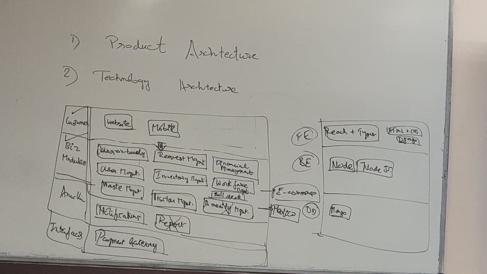
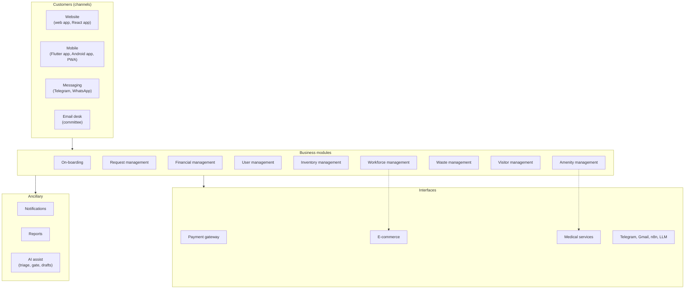
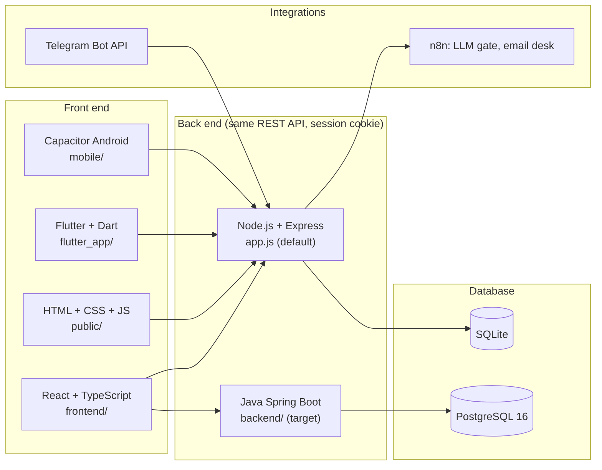
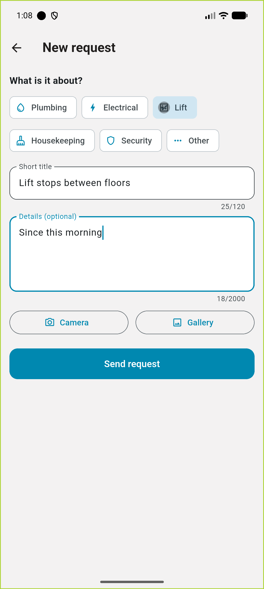
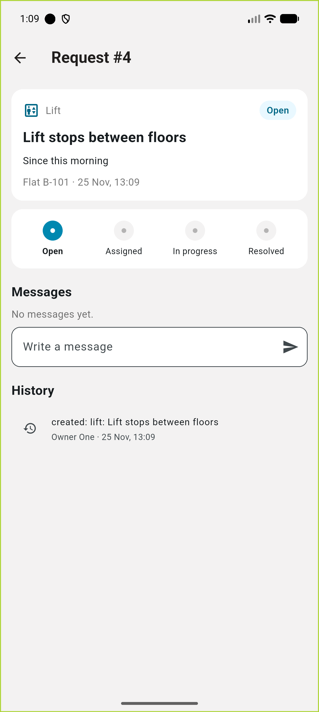
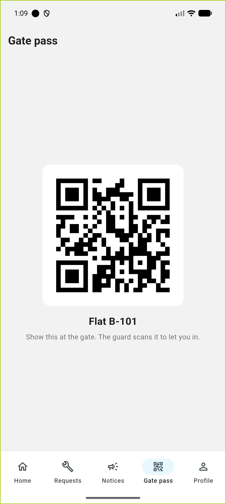

# Product architecture and technology architecture

Source: the faculty whiteboard, class review 2026-11-25. It asks for a product view (users, modules, ancillary services, interfaces) and a technology view (one choice per tier). Component diagrams and the data model are in [architecture.md](architecture.md).

---

## 1. Product architecture

| Layer | On the board | What it means for Sahyadri Heights |
|---|---|---|
| **Customers** (channels) | Website, Mobile | How residents, the committee, staff and guards reach the product |
| **Business modules** | On-boarding, Request management, Financial management, User management, Inventory management, Workforce management, Waste management, Visitor management, Amenity management | The society's day-to-day work |
| **Ancillary** | Notifications, Reports | Services every module uses |
| **Interfaces** | Payment gateway, E-commerce, "Medico" (read as medical services; hard to read) | Outside systems |

### Module status in our build

Built = working in the Node API and web app. Partial = some of it built. Planned = not built. Amenities, dues, inventory and waste (2026-11-25, [modules-api.md](../modules-api.md)) are in the web and Flutter apps, not yet in Java or React.

| Module | Status | What exists today | Where |
|---|---|---|---|
| On-boarding | Built | Self-registration with consent, committee approval, owner adds family and tenants, tenant lease | `app.js` `/api/register`, `/api/household`, `/api/admin/users` |
| Request management | Built | Raise with photo, AI triage, forward-only lifecycle, vendor or staff assignment, messages, rating, reopen within 7 days, SLA escalation, Telegram intake (WhatsApp built, not connected), email actions | `app.js` `/api/requests*`, `ai.js`, `email-desk.js` |
| User management | Built | Roles (resident, committee, guard, staff, IT), committee positions (member, head, admin), access matrix per resident type, suspend and remove | `app.js` `/api/admin/users`, `/api/admin/access`, `roles.js` |
| Visitor management | Built | Visitor gate passes, the resident's personal QR and NFC gate token, the guard's verify screen, gate log | `app.js` `/api/gate/*` |
| Workforce management | Partial | Vendors, staff jobs (accept, update, hand over), shifts (punch in and out), society workers register | `roles.js` `/api/staff/*`, `app.js` vendors and workers |
| Financial management | Built | Maintenance bills per flat, recorded payments (cash, UPI, bank, cheque), part payments, overdue tracking, collection totals; cost estimates over the approval limit need the head of committee | `modules.js` `/api/dues`, `roles.js` cost approval |
| Inventory management | Built | Items with reorder levels, stock in and out (staff take stock out for a job), movement history, low-stock alerts | `modules.js` `/api/inventory` |
| Waste management | Built | Weekly pickup schedule by waste type, collection log with weights and segregation share, residents report a missed pickup as a housekeeping request | `modules.js` `/api/waste/*` |
| Amenity management | Built | Committee sets up amenities and hours; residents book time slots (no double booking, 30 days ahead, 2 upcoming per flat) and cancel | `modules.js` `/api/amenities`, `/api/bookings` |
| Notifications | Built | In-app notifications, Telegram replies, notice broadcast, committee email desk, emergency alerts | `app.js`, `email-desk.js` |
| Reports | Built | Monthly report, CSV export, weekly AI digest, audit trail | `roles.js` `/api/admin/reports/monthly`, `app.js` |
| Payment gateway | Planned | Not built. Online payment would add a "Pay now" step on the existing bill records | |
| E-commerce, medical | Planned | Not built. Emergency alerts of type "medical" exist | |

---

## 2. Technology architecture

| Tier | On the board | Our build | Why |
|---|---|---|---|
| **FE** (front end) | React + TypeScript (also HTML + CSS, Django) | React 18 + TypeScript + Vite (`frontend/`); HTML + CSS + vanilla JS web app (`public/`) | Same as the board. The vanilla app came first and has no build step; React is the target ([ADR 0001](adr-0001-java-react.md)) |
| **Mobile** | "Mobile" channel | **Flutter + Dart** (`flutter_app/`), plus the Capacitor Android wrapper (`mobile/`) | Flutter gives one Dart codebase for Android and iOS with native widgets. The Capacitor app stays for NFC gate tags until Flutter has them |
| **BE** (back end) | Node, Node JS | Node.js 22 + Express (default, `app.js`); Java Spring Boot 3.3 (`backend/`, target) | Node as on the board. The Java port follows the same frozen API contract |
| **DB** | Mongo | SQLite (`node:sqlite`) for the Node app; PostgreSQL 16 for Java and production | Our data is relational (users, flats, requests, approvals, audit) and needs joins and transactions, so we chose SQL. MongoDB would fit if modules like amenity bookings or IoT logs became document-shaped |
| **Integration** | (not on the board) | n8n cloud workflows, Telegram Bot API, Gmail, LLM (gpt-4o-mini via n8n) | AI-native workflows: request-or-chatter gate, email approvals, digests |
| **Hosting and CI** | (not on the board) | Render (web service), GitHub Actions (6 jobs), Docker | Free hosting for the demo; CI checks every stack |

### Flutter app

`flutter_app/` (Flutter 3.50, Dart 3.14) calls the same REST API with the session cookie from `POST /api/login`; no server change was needed. The bottom navigation depends on the role (resident, committee, staff, guard and IT). Checked on an Android emulator against a local server; not on a physical phone, iOS or the live server. Build, run and open items: [flutter_app/README.md](../../flutter_app/README.md).

| Home | New request | Request detail | Gate pass |
|---|---|---|---|
|  |  |  |  |
