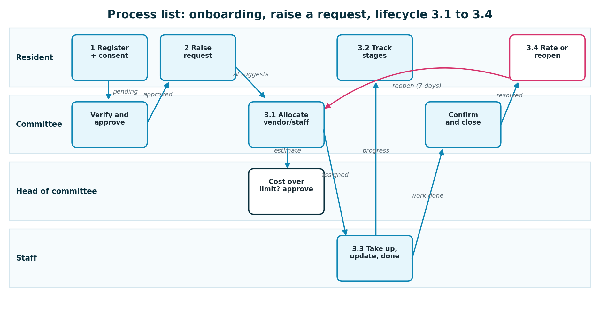
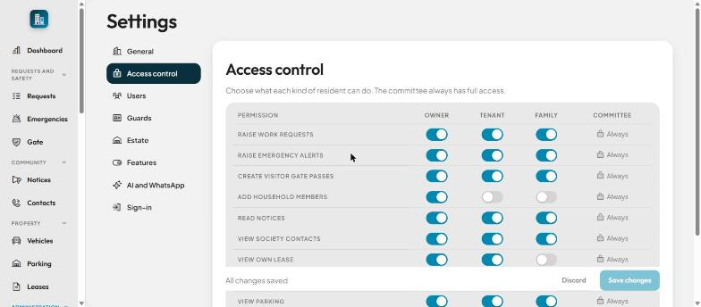

# Requirements: Sahyadri Heights Housing Society Portal

Source: BPA "Using AI" Session 3 brief (slides 4-9, 13), faculty review (2026-11-21) and faculty whiteboard (2026-11-25). Stories by role: `user-stories.md`. MoSCoW follows slide 8; **(extra)** marks items beyond slide 8. Everything listed is built in the Node app and web UI unless a status note says otherwise (updated 2026-11-25).

## 1. Scope
A society of several hundred flats runs on WhatsApp groups, paper registers and phone calls. Residents cannot track complaints, the committee cannot see what is pending, and records are scattered. Goal: one portal to know who lives there, resolve their requests and communicate reliably.

Five core requirements (slide 6): onboarding, work requests, communication, visibility, accountability. Also in scope: household, leases, emergencies, contacts, gate passes, vehicles, parking, workers, feature flags, review roles, society modules, and the AI workflows in section 4.

## 2. Personas
| Persona | Main needs |
| --- | --- |
| Owner | Raise, track and rate requests (also for family); add family and tenants; gate passes; book amenities; see dues |
| Tenant | Raise requests; see own lease; notices |
| Family member | Raise and see flat requests; never rates (owner rates) |
| Committee member | Approve residents, assign work, move requests, notices, dashboard, audit, society modules |
| Head of committee (`head`) | Approve costs above the limit; settings, access rules, accounts |
| Admin (`sysadmin`) | Accounts for every role, settings, feature switches, channels |
| Staff (`staff`) | Own jobs, progress, punch in/out, hand-over, stock out, waste logs |
| IT staff (`it`) | Support tickets, guides, health, backup, maintenance notice |
| Guard | Verify passes and resident tokens; gate log |
| Messaging-only resident | Report a problem on Telegram and get replies in the chat |
| Committee member away from the dashboard | Act on new items from email |




## 3. Functional requirements
M Must, S Should, C Could. IDs are stable and referenced by `testing/test-cases.md`.

### Epic 1: Onboarding
| ID | Requirement | MoSCoW |
| --- | --- | --- |
| FR-ON-01 | Register as owner, tenant or family with flat, phone, password (8-128) and explicit DPDP consent; account starts `pending` | M |
| FR-ON-02 | Committee approves or rejects; only approved users sign in; suspended or removed accounts are blocked with a message | M |
| FR-ON-03 | Committee is notified of each registration | M |
| FR-ON-04 | Owner adds family or tenant to own flat (`pending`, committee approves) | S (extra) |
| FR-ON-05 | Committee records a tenant lease; the tenant reads it | C (extra) |

### Epic 2: Authentication and roles
| ID | Requirement | MoSCoW |
| --- | --- | --- |
| FR-AU-01 | Email and password sign-in, bcrypt hashes, httpOnly SameSite session cookie (Secure in production) | M |
| FR-AU-02 | Role check on every route | M |
| FR-AU-03 | Login throttling (5 failures / 15 min) and equal timing for unknown emails | M |
| FR-AU-04 | Committee-editable permission matrix for owner, tenant, family | S (extra) |
| FR-AU-05 | Feature flags switchable by the committee | C (extra) |
| FR-AU-06 | Guards limited to a strict route allow-list | M (extra) |
| FR-AU-07 | Committee password reset signs the user out everywhere | S |
| FR-AU-08 | Google sign-in for existing accounts (off by default) | C (extra) |



### Epic 3: Work requests
| ID | Requirement | MoSCoW |
| --- | --- | --- |
| FR-WR-01 | Raise a request: category, title, description, optional photo (JPEG/PNG/WebP, 5 MB, signature checked) | M |
| FR-WR-02 | Forward-only lifecycle open > assigned > in_progress > closed; an assignee is required to progress | M |
| FR-WR-03 | Status history from the audit trail; comments | M |
| FR-WR-04 | Residents see own and own-flat requests; committee sees all | M |
| FR-WR-05 | Requester rates a closed request once (1-5); the owner rates for family | S |
| FR-WR-06 | Vendor directory | C |
| FR-WR-07 | WhatsApp intake by registered phone. Not verified: WhatsApp not connected (Meta blocks new business portfolios) | S |
| FR-WR-08 | AI triage: category, priority, summary, suggested vendor; PII stripped; rules unless `ANTHROPIC_API_KEY` is set | S |
| FR-WR-09 | AI only suggests; a committee member confirms; audited | M |
| FR-WR-10 | 48 h SLA; overdue requests escalated to the committee | C |
| FR-WR-11 | Status replies in the resident's chat. Not verified on WhatsApp (not connected) | S |
| FR-WR-12 | Message gate: request / unsure / chatter; chatter ignored; unsure goes to a Needs review queue | M |
| FR-WR-13 | Telegram intake: link by sharing contact, then messages become requests; replies in the chat | S (extra) |
| FR-WR-14 | Gate can run on a free n8n LLM (`CLASSIFY_WEBHOOK_URL`) with rules fallback | S (extra) |
| FR-WR-15 | AI suggested action approved or dismissed with one click; audited | S (extra) |
| FR-WR-16 | Committee email desk: signed 7-day stage buttons run the same action as the dashboard | S (extra) |

### Epic 4: Notifications
| ID | Requirement | MoSCoW |
| --- | --- | --- |
| FR-NO-01 | In-app notification for status change, assignment, approval, rating | S |
| FR-NO-02 | Committee posts notices; residents are alerted | S |
| FR-NO-03 | Live updates by polling `/api/pulse` | S (extra) |
| FR-NO-04 | AI notice drafter; the committee edits and sends | C |
| FR-NO-05 | Weekly AI digest for the committee | C |
| FR-NO-06 | Emergency alerts; contacts directory | C (extra) |
| FR-NO-07 | Emergency words in a message create an emergency; emergencies are always emailed | S (extra) |
| FR-NO-08 | Registrations and review-queue messages emailed with Approve / Reject buttons when nobody is on the dashboard | S (extra) |

### Epic 5: Admin dashboard
| ID | Requirement | MoSCoW |
| --- | --- | --- |
| FR-AD-01 | Dashboard: by category and status, SLA, unassigned, awaiting rating, volume, vendor ratings | S |
| FR-AD-02 | Estate overview: residents, gate, parking, vehicles, workers | S (extra) |
| FR-AD-03 | Audit trail of every state change (latest 200 shown) | M |
| FR-AD-04 | CSV export of requests | C |
| FR-AD-05 | Gate passes (QR + 6-digit code), resident token, guard verify, gate log; vehicles, parking, workers | C (extra) |

### Epic 6: Non-functional
See section 5.

### Epic 7: Review roles (2026-11-21)
API: `roles-api.md`. Not ported to Java/React.

| ID | Requirement | MoSCoW |
| --- | --- | --- |
| FR-RL-01 | Committee positions member, head, admin; only head or admin change settings, access, accounts, Telegram webhook | M |
| FR-RL-02 | Accounts page for every role; nobody suspends or demotes themselves; one head or admin always stays | M |
| FR-RL-03 | Staff login sees only own jobs (strict allow-list) | M |
| FR-RL-04 | Assign a request to a vendor or a staff member | M |
| FR-RL-05 | Staff take up a job and post progress with note and photo; "work done" asks the committee to close | M |
| FR-RL-06 | Punch in/out; hand open jobs to a colleague at punch-out | S |
| FR-RL-07 | Cost above the approval limit (default Rs 10,000) needs the head (admin if no head) | S |
| FR-RL-08 | Reopen a closed request within 7 days with a reason | S |
| FR-RL-09 | Printable monthly report incl. activity per committee member | S |
| FR-RL-10 | Notices also sent on Telegram | C |
| FR-RL-11 | Support tickets from every role; IT replies | S |
| FR-RL-12 | Help guides per role | C |
| FR-RL-13 | IT tools: health, backup download (audited), maintenance notice | S |


### Epic 8: Society modules (2026-11-25)
API: `modules-api.md`. Node and web only; not ported to Java/React/Flutter. Jira: to add.

| ID | Requirement | MoSCoW |
| --- | --- | --- |
| FR-SM-01 | Committee sets up amenities with hours and slot length, and can close one | S |
| FR-SM-02 | Residents book a free slot (no double booking, up to 30 days ahead, max 2 upcoming per flat per amenity) and cancel | S |
| FR-SM-03 | Committee raises monthly dues for every flat or listed flats; no duplicate bill per flat, period and title | S |
| FR-SM-04 | Committee records payments (cash, UPI, bank, cheque; part payments; optional reference); status unpaid / partial / paid / overdue with totals | S |
| FR-SM-05 | Residents see their own flat's dues and payments only. Online payment: planned, not built | S |
| FR-SM-06 | Inventory items with reorder level; committee stock in and out, staff stock out only; never below 0; history; low-stock alert | C |
| FR-SM-07 | Weekly waste pickup schedule by kind (wet, dry, recyclable, hazardous, e-waste) | C |
| FR-SM-08 | Staff and committee log collections in kg; segregated share shown | C |
| FR-SM-09 | Resident reports a missed pickup; it becomes a housekeeping request | C |
| FR-SM-10 | "Society services" row on the resident home and committee dashboard | S |

## 4. AI-native workflow
```
Telegram (or WhatsApp, not connected) message -> webhook -> AI gate (request / unsure / chatter)
  -> request -> AI triage (PII stripped; LLM or rules)
  -> suggestion to committee (dashboard, or email when nobody is on it)
  -> committee assigns, approves start, approves done -> replies in chat -> rating
SLA 48 h -> escalation;  weekly digest;  notice drafter -> committee edits and sends
```
AI suggests; a committee member confirms assignments and sends notices.

## 5. Non-functional requirements
| ID | Area | Requirement |
| --- | --- | --- |
| NFR-01 | Security | Hashed passwords, role check per route, parameterised SQL, escaped output, strict CSP, CSRF origin check, no secrets in the repo |
| NFR-02 | Privacy | Consent timestamp; minimum data; synthetic data in development (`privacy-and-consent.md`) |
| NFR-03 | Transport | HTTPS in production (Secure cookie, HSTS) |
| NFR-04 | Availability | `/healthz` and Actuator health; backups. No uptime target set |
| NFR-05 | Accessibility | Keyboard-usable, labelled inputs. Not verified: no WCAG audit |
| NFR-06 | Usability | Desktop and phone; PWA, Android wrapper, Flutter app |
| NFR-07 | Maintainability | Tests per story (node:test, JUnit, Vitest, Flutter); one API contract for all clients |
| NFR-08 | Portability | Node + SQLite now; Java + PostgreSQL side by side (ADR 0001) |
| NFR-09 | AI safety | No names, phones, emails or flat numbers sent to a model; output is a suggestion; rules fallback; audited |
| NFR-10 | Auditability | Every state change writes `audit` |
| NFR-11 | Rate limiting | Login throttling; webhook shared secrets. Not built: WhatsApp provider signature check, webhook rate limit |
| NFR-12 | Performance | No load target set or measured |
| NFR-13 | Email actions | HMAC-signed 7-day token per item; GET only shows a confirm page; action replays the dashboard route |
| NFR-14 | Hosting | Free plan wipes SQLite on sleep/redeploy; test accounts re-seeded from env. Durable data needs a paid disk or hosted database |

## 6. Assumptions
- The partner society gives written permission before testing with residents.
- A resident's registered phone number is their identity for message intake.
- Telegram is the live channel; no paid LLM key is needed (n8n free credits or rules).
- The committee has a Gmail account connected to n8n.
- The committee owns every decision that costs money or goes to all residents.

## 7. Out of scope
Online payments (dues are recorded by the committee; a gateway is planned), visitor management beyond resident-created gate passes, IoT and biometrics, polls, automatic vendor dispatch, AI acting without human confirmation.
