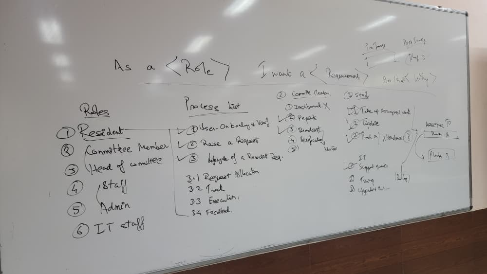

# Requirements Document: Sahyadri Heights Housing Society Portal

Version 2.0, 2026-11-25. Sources: BPA "Using AI" Session 3 brief, faculty whiteboards of 2026-11-21 (roles, process list) and 2026-11-25 (product and technology architecture). Stories in the form *As a <Role>, I want <Requirement>, so that <Why>* are in [user-stories.md](user-stories.md).



## 1. Scope

**Problem.** The society (several hundred flats) runs on WhatsApp groups, paper registers and phone calls. Residents cannot track complaints, the committee cannot see what is pending, and nobody is accountable.

**Goal.** One portal to know who lives in the society, resolve their requests and communicate reliably.

**In scope** (product architecture, 2026-11-25)

| Layer | Included |
| --- | --- |
| Channels | Website, mobile app, Telegram, committee email |
| Business modules | On-boarding, user management, request management, workforce management, amenity management, financial management (dues), inventory management, waste management, visitor management (gate passes, parcel desk) |
| Resident services | Tuck shop (the e-commerce interface on the whiteboard), laundry service, community events |
| Ancillary | Notifications, reports, AI assist (suggestions only) |

**Out of scope.** Online payments (payment gateway planned; shop and laundry are paid on delivery), medical services, IoT and biometrics, polls, AI acting without a person confirming.

**Assumptions.** The society gives written permission before testing with residents; a resident's registered phone is their identity on messaging; the committee owns every decision that costs money or reaches all residents.

## 2. Personas

The six roles from the whiteboard.

| # | Persona | Who | Goals | Pain today |
| --- | --- | --- | --- | --- |
| 1 | **Resident** | Owner, tenant or family member of a flat | Report a problem once, see who is on it, rate the work; book amenities; know dues | Complaints get lost in WhatsApp; no status; calls go unanswered |
| 2 | **Committee Member** | Elected volunteer, part-time | Verify residents, allocate work, see what is pending, broadcast notices | No single list of open work; chasing vendors by phone |
| 3 | **Head of Committee** | Chair of the committee | Approve costly work, set rules, account to the general body | Spending decided informally; no audit trail |
| 4 | **Staff** | Society staff (plumber, electrician, housekeeping, guard) | Take up assigned work, update progress, punch in and out | Jobs given verbally; no record of work done |
| 5 | **Admin** | Society office manager | Manage accounts, settings and access for every role | User lists on paper; access never revoked |
| 6 | **IT Staff** | Support person for the portal | Answer support queries, train users, keep the system healthy and upgraded | No channel for issues; no backups |

### Owner, tenant, family and committee

| | Owner | Tenant | Family member | Committee member |
|---|---|---|---|---|
| **Who** | Owns the flat | Rents the flat from the owner | Lives in the flat with the owner | Resident elected to run the society |
| **Account** | Resident | Resident | Resident | Committee (position member; head and admin are senior positions) |
| **Raise and track requests** | Yes, for the whole flat | Yes, for the flat | Yes, for the flat | Sees and handles everyone's requests |
| **Rate finished work** | Yes, also for the family | Yes, own requests | No (the owner rates) | No |
| **Add family or tenants** | Yes (committee approves) | No | No | Approves new residents (Verification) |
| **Lease** | - | Reads own lease | - | Records tenants' leases |
| **Money** | The flat's dues and shop/laundry credit | Same flat account (shared) | Same flat account (shared) | Raises bills and records payments for all flats |
| **Runs the society** | No | No | No | Assigns work, notices, reports, monitoring |

Head of committee: everything a member does plus approving costs above the limit (default Rs 10,000) and governing settings and accounts. Admin: accounts for every role, settings, access rules and system health. What each resident type may do is a default the committee can change in Settings > Access.

## 3. Functional Requirements

Priority: M Must, S Should, C Could (MoSCoW). IDs are stable and traced in [test-cases.md](testing/test-cases.md). Everything is built in the web app unless marked *not built*.

### 3.1 Process 1: User on-boarding and verification
| ID | Requirement | Role | Priority |
| --- | --- | --- | --- |
| FR-ON-01 | Register as owner, tenant or family with flat, phone, password and explicit consent; account starts *pending* | Resident | M |
| FR-ON-02 | Approve or reject a registration; only approved users sign in | Committee Member | M |
| FR-ON-03 | Be notified of every new registration | Committee Member | M |
| FR-ON-04 | Owner adds family or tenants to their own flat (committee approves) | Resident | S |
| FR-ON-05 | Record a tenant's lease; the tenant can read it | Committee Member | C |
| FR-AU-01 | Sign in with email and password; secure session | All | M |
| FR-AU-02 | Every screen and action checks the user's role | All | M |
| FR-AU-03 | Lock out repeated failed sign-ins (5 in 15 min) | All | M |
| FR-AU-07 | Reset a user's password and sign them out everywhere | Admin | S |
| FR-AU-08 | Google sign-in for existing accounts (off by default) | All | C |

### 3.2 Process 2: Raise a request
| ID | Requirement | Role | Priority |
| --- | --- | --- | --- |
| FR-WR-01 | Raise a request with category, title, description and optional photo | Resident | M |
| FR-WR-13 | Raise a request by Telegram message and get replies in the chat | Resident | S |
| FR-WR-07 | Raise a request by WhatsApp (*not built: WhatsApp not connected*) | Resident | S |
| FR-WR-12 | Messages are sorted into request, unsure or chatter; unsure ones go to a review queue | Committee Member | M |
| FR-WR-14 | Sorting can use a free LLM, with a rules fallback | IT Staff | S |
| FR-NO-06 | Raise an emergency in one action; emergency contacts directory | Resident | C |
| FR-NO-07 | Emergency words in a message create an emergency, always emailed to the committee | Resident | S |

### 3.3 Process 3: Lifecycle of a resident request
**3.1 Allocation**
| ID | Requirement | Role | Priority |
| --- | --- | --- | --- |
| FR-WR-08 | AI suggests category, priority, summary and vendor; personal data is stripped first | Committee Member | S |
| FR-WR-09 | AI only suggests; a person confirms; both are audited | Committee Member | M |
| FR-WR-15 | Approve or dismiss an AI suggestion in one click | Committee Member | S |
| FR-RL-04 | Assign a request to a vendor (e.g. Plumber A) or a staff member | Committee Member | M |
| FR-WR-06 | Vendor directory | Committee Member | C |
| FR-RL-07 | Cost above the limit (default Rs 10,000) needs the head's approval | Head of Committee | S |

**3.2 Track**
| ID | Requirement | Role | Priority |
| --- | --- | --- | --- |
| FR-WR-02 | Forward-only stages: open, assigned, in progress, closed | All | M |
| FR-WR-03 | Stage history and comments on each request | Resident, Committee Member | M |
| FR-WR-04 | Residents see their own flat's requests; the committee sees all | Resident, Committee Member | M |
| FR-NO-01 | Notify on stage change, assignment, approval and rating | All | S |
| FR-NO-03 | Screens update live | All | S |
| FR-WR-10 | Requests open over 48 h are escalated to the committee | Committee Member | C |
| FR-WR-11 | Stage updates sent to the resident's chat (*WhatsApp not connected*) | Resident | S |

**3.3 Execution**
| ID | Requirement | Role | Priority |
| --- | --- | --- | --- |
| FR-RL-05 | Take up an assigned job and post progress with note and photo; "work done" asks the committee to close | Staff | M |
| FR-RL-06 | Punch in and out; hand open jobs to a colleague at punch-out | Staff | S |

**3.4 Feedback**
| ID | Requirement | Role | Priority |
| --- | --- | --- | --- |
| FR-WR-05 | Rate closed work once (1-5); the owner rates for family members | Resident | S |
| FR-RL-08 | Reopen a closed request within 7 days with a reason | Resident | S |

### 3.4 Committee Member: dashboard, reports, broadcast, monitoring
| ID | Requirement | Role | Priority |
| --- | --- | --- | --- |
| FR-AD-01 | Dashboard: requests by category and status, overdue, unassigned, vendor ratings | Committee Member | S |
| FR-AD-02 | Estate overview: residents, gate, parking, vehicles, workers | Committee Member | S |
| FR-RL-09 | Printable monthly report, including activity per committee member | Committee Member | S |
| FR-AD-04 | Export requests to CSV | Committee Member | C |
| FR-NO-05 | Weekly AI digest | Committee Member | C |
| FR-NO-02 | Post notices; residents are alerted | Committee Member | S |
| FR-NO-04 | AI drafts a notice; the committee edits and sends | Committee Member | C |
| FR-RL-10 | Notices also sent on Telegram | Committee Member | C |
| FR-AD-03 | Audit trail of every change | Committee Member | M |
| FR-WR-16 | Act on requests from email with signed buttons | Committee Member | S |
| FR-NO-08 | Registrations and review items emailed when nobody is on the dashboard | Committee Member | S |

### 3.5 Head of Committee and Admin: governance
| ID | Requirement | Role | Priority |
| --- | --- | --- | --- |
| FR-RL-01 | Only the head or admin change settings, access rules and accounts | Head of Committee, Admin | M |
| FR-RL-02 | Create and manage accounts for every role (incl. tuck shop owner and laundry service); lists show the person only, actions sit behind a ⋯ menu; nobody suspends or demotes themselves; one head or admin always remains | Admin | M |
| FR-AU-04 | Edit what owners, tenants and family may do | Admin | S |
| FR-AU-05 | Switch features on and off | Admin | C |

### 3.6 Staff: limited access
| ID | Requirement | Role | Priority |
| --- | --- | --- | --- |
| FR-RL-03 | Staff see only their own jobs | Staff | M |
| FR-AU-06 | Guards reach only the gate screens | Staff (guard) | M |
| FR-AD-05 | Gate passes (QR and 6-digit code), resident token, guard check, gate log | Resident, Staff (guard) | C |
| FR-GT-01 | The guard registers an NFC card to a resident or staff member (phone NFC or USB reader) | Staff (guard) | S |
| FR-GT-02 | Tapping a card checks the holder in, the next tap checks them out, with timestamps; for staff the tap starts or ends the shift | Staff (guard) | S |
| FR-RL-15 | Staff see only their department: cleaning (cleaning jobs, waste), maintenance (repair jobs, inventory), tuck shop, laundry | Staff | M |

### 3.7 IT Staff: support, training, upkeep
| ID | Requirement | Role | Priority |
| --- | --- | --- | --- |
| FR-RL-11 | Support tickets from every role; IT replies | IT Staff | S |
| FR-RL-12 | Help guides per role (training) | IT Staff | C |
| FR-RL-13 | Upgrades and maintenance: system health, backup download (audited), maintenance notice | IT Staff | S |
| FR-RL-14 | IT overview home: system status, open support queries, training guides, last backup, maintenance notice and log | IT Staff | S |

### 3.8 Society modules
| ID | Requirement | Role | Priority |
| --- | --- | --- | --- |
| FR-SM-01 | Set up amenities with hours and slot length; close one | Committee Member | S |
| FR-SM-02 | Book a free slot (no double booking, up to 30 days ahead, 2 upcoming per flat) and cancel | Resident | S |
| FR-SM-03 | Raise monthly dues for all or listed flats; no duplicate bill | Committee Member | S |
| FR-SM-04 | Record payments (cash, UPI, bank, cheque, part payments); status unpaid, partial, paid, overdue | Committee Member | S |
| FR-SM-05 | See own flat's dues and payments (*online payment not built*) | Resident | S |
| FR-SM-06 | Inventory with reorder level; stock in and out, never below 0; low-stock alert | Committee Member, Staff | C |
| FR-SM-07 | Weekly waste pickup schedule by kind | Committee Member | C |
| FR-SM-08 | Log collections in kg; show segregated share | Staff | C |
| FR-SM-09 | Report a missed pickup; it becomes a request | Resident | C |
| FR-SM-10 | Calm dashboard for every role: greeting, one status line, and a short "For you" list of what needs the person now | Resident, Committee Member | S |
| FR-SM-11 | Each role has its own dashboard look (illustration, colours, content); head of committee (governance), admin (system) and committee member (operations) are strictly different, including their top bars | All | S |

### 3.9 Resident services
| ID | Requirement | Role | Priority |
| --- | --- | --- | --- |
| FR-SV-01 | Tuck shop: the committee lists items with price and stock; residents order for delivery; stock never goes below 0 | Resident, Committee Member | C |
| FR-SV-02 | The tuck shop owner gets new orders and moves them placed, ready, delivered; residents cancel until ready (stock goes back); the committee only sees the state | Tuck shop owner, Resident | C |
| FR-SV-03 | Laundry: the committee sets prices; residents book a pickup (date and time slot) with items | Resident, Committee Member | C |
| FR-SV-04 | The laundry service moves laundry requested, picked up, washing, ready, delivered, one step at a time; the flat is told at each step; the committee only sees the state | Laundry service | C |
| FR-SV-05 | Parcel desk: the guard logs a delivery for a flat, the flat is told, the guard marks it collected | Staff (guard), Resident | S |
| FR-SV-06 | Community events: the committee posts and cancels events; residents say they are going | Committee Member, Resident | C |

## 4. Non-Functional Requirements

| ID | Area | Requirement |
| --- | --- | --- |
| NFR-01 | Security | Hashed passwords, role check on every route, parameterised SQL, escaped output, strict CSP, CSRF check, no secrets in the code |
| NFR-02 | Privacy | Explicit consent with timestamp; minimum data; synthetic data only in development ([privacy-and-consent.md](privacy-and-consent.md)) |
| NFR-03 | Transport | HTTPS in production; secure cookies |
| NFR-04 | Availability | Health check endpoint and backups. Uptime target not set |
| NFR-05 | Accessibility | Keyboard-usable, labelled inputs. No WCAG audit yet |
| NFR-06 | Usability | Works on desktop and phone (web, PWA, Flutter app). Each role's required items sit in a top bar named as on the faculty whiteboard; extras sit in the sidebar |
| NFR-07 | Maintainability | Automated tests for every story; one API for all clients; CI on every change |
| NFR-08 | Portability | Runs on SQLite now; PostgreSQL-ready backend |
| NFR-09 | AI safety | No names, phones, emails or flat numbers sent to a model; AI output is a suggestion; works without AI |
| NFR-10 | Auditability | Every state change is logged with who, what and when |
| NFR-11 | Abuse protection | Sign-in throttling; webhooks need a shared secret. Webhook rate limit not built |
| NFR-12 | Performance | No load target set or measured |
| NFR-13 | Email actions | Signed links valid 7 days; opening a link never acts without a confirm click |
| NFR-14 | Hosting | Free hosting resets the database; production needs a persistent database |

## 5. Technology stack and how the front end and back end connect

| Tier | What |
| --- | --- |
| **Clients** | Web app (vanilla JavaScript, no build step) at / ; installable phone app (PWA) at /m/ ; Android wrapper (Capacitor) ; Flutter app ; React + TypeScript app (migration target) |
| **API** | One REST API with JSON over HTTPS: Node 22 + Express (system of record). A Java Spring Boot API with the same URLs and JSON is the migration target |
| **Security** | Session cookie (httpOnly, SameSite, Secure in production) after POST /api/login; role check on every route; strict allow-lists for guard, staff, IT, shop and laundry; CSRF origin check; strict Content Security Policy |
| **Data** | SQLite (node:sqlite) for the Node API; PostgreSQL 16 for the Java API and production; photos in an upload folder |
| **Integrations** | Telegram Bot API (message intake), n8n workflows (free LLM gate, Gmail email desk), optional Anthropic API for triage, Web NFC / USB readers for cards |
| **Hosting** | Render (Docker), deployed from GitHub; CI runs Node, Java (H2 and PostgreSQL), React, Docker and Flutter checks on every pull request |

```
Web app (/)   Phone app (/m/)   Flutter app   React app
        \           |             |            /
         HTTPS + JSON, session cookie after POST /api/login
                              |
               REST API (Node + Express; Java Spring Boot later)
       role check on every route · audit trail · notifications
              |                    |                     |
      SQLite / PostgreSQL     Telegram · n8n · Gmail     Web NFC / USB card reader
```

**How a screen gets its data**

1. The browser or app signs in with POST /api/login and receives a session cookie.
2. Every screen calls the REST API with fetch (JSON); the cookie identifies the person and the server checks the role.
3. The API reads and writes the database and records every change in the audit trail.
4. Changes notify people (in-app notifications, Telegram, email) and the screens refresh within seconds by polling /api/pulse.
5. The same API serves every client, so the web app, phone app and Flutter app always show the same data.

**API map** (contracts in `docs/*-api.md`)

| Area | Main routes | Used by | Contract |
| --- | --- | --- | --- |
| Sign-in and profile | `/api/login, /api/logout, /api/register, /api/me` | All | app.js |
| Requests (lifecycle) | `/api/requests, /api/requests/:id/status, /assign, /rate, /reopen` | Resident, committee, staff | app.js, roles.js |
| Committee administration | `/api/admin/users, /api/admin/stats, /api/admin/settings, /api/admin/access, /api/admin/audit` | Committee | app.js |
| Roles, staff and IT | `/api/admin/accounts, /api/staff/*, /api/admin/approvals, /api/admin/reports/monthly, /api/support, /api/it/*` | Committee, staff, IT | roles-api.md |
| Notices and alerts | `/api/notices, /api/notifications, /api/emergencies, /api/pulse` | All | app.js |
| Gate and visitors | `/api/gate/passes, /api/gate/verify, /api/gate/log, /api/parcels` | Resident, guard, committee | app.js, services-api.md |
| Community cards (NFC) | `/api/gate/cards, /api/gate/tap, /api/gate/presence, /api/admin/users/:id/card, /api/me/card` | Guard, committee, everyone (own card) | nfc-api.md |
| Society modules | `/api/amenities, /api/bookings, /api/dues, /api/admin/dues, /api/inventory, /api/waste/*` | Resident, committee, staff | modules-api.md |
| Resident services | `/api/shop/*, /api/laundry/*, /api/events, /api/credit, /api/services/summary` | Resident, shop, laundry, committee | services-api.md |
| Message intake | `/api/telegram/webhook, /api/whatsapp/webhook (secret-checked)` | Telegram, WhatsApp provider | app.js |
| Email desk | `/desk/:token (signed 7-day links)` | Committee by email | email-desk.js |

## 6. Tests done

| Suite | Tests | Covers |
| --- | --- | --- |
| Node API (node:test) | 86 | Every story; runs in CI |
| Integration (agents, cross-module) | 53 | Onboarding, requests, money, access, dashboards, web wiring |
| Java API (JUnit) | 81 | Same API on H2 and PostgreSQL 16 |
| React app (Vitest) | 67 | Migration client |
| Flutter app | 18 | Phone app |

| Also | |
| --- | --- |
| Documented test cases | 80 |
| Requirements linked to tests | 72 of 76 |
| Defects logged (all fixed or tracked) | 29 |
| CI jobs on every pull request | 6 |

Browser walkthroughs of every role on a local server (resident, committee member, head, admin, cleaner, maintenance, guard, tuck shop, laundry, IT); emulator checks of the Flutter app; live checks after each deploy. Details: `docs/testing/`.

## 7. Capacity and scaling

Measured on Intel(R) Core(TM) i5-10300H CPU @ 2.50GHz · 8 cores · Node v24.15.0 with the real server and a seeded database (9 MB). One active user = 0.3 requests/s (live refresh every 5 s plus page loads). Supported = highest load with p95 under 500 ms and no errors.

**Result: about 210 requests/s sustained, which is about 700 people using the portal at the same moment.** Sign-ins: about 14 per second (password hashing).

| Requests in flight | Requests/s | p50 ms | p95 ms | Errors |
| --- | --- | --- | --- | --- |
| 10 | 202 | 48 | 68 | 0 |
| 50 | 210 | 244 | 275 | 0 |
| 100 | 206 | 497 | 598 | 0 |
| 200 | 212 | 952 | 1072 | 0 |
| 400 | 242 | 1865 | 3219 | 0 |

| Database | |
| --- | --- |
| Data tested | 2,000 residents, 20,000 requests, 100,000 audit rows, 5,000 orders = 9 MB |
| Growth | about 75 bytes per stored record; a 500-flat society for 5 years stays well under 1 GB |
| SQLite limits | Files up to 281 TB; one writer at a time (fine for one society); no network access |
| Free hosting | Render free plan: 0.1 CPU and the database is wiped on redeploy; plan figures are lower than this machine |

**To scale**

| When | Change | Tools |
| --- | --- | --- |
| One society, up to about 700 people at once (measured) | Today's setup, on a paid instance with a persistent disk | Render Starter + disk (fixes the data wipe) |
| Several hundred to a few thousand active users | Move data to PostgreSQL (the Java API is ready for it); run 2+ app instances behind the load balancer; keep sessions in the database or Redis | PostgreSQL 16, Redis, 2-4 instances |
| Many societies / tens of thousands | Multi-tenant data (society id), push updates instead of 5 s polling, object storage for photos, read replicas, rate limits | Managed PostgreSQL + replicas, S3, WebSockets/SSE |

Re-run: `node scripts/load-test/load.js`.
