# User Stories by Role: Sahyadri Heights Housing Society Portal

Form: **As a <role>, I want <requirement>, so that <why>** (faculty review, 2026-11-21; society modules from the whiteboard, 2026-11-25). FR IDs are in `requirements.md`. All stories are built in the Node app and web UI; review-role and society-module stories are not yet ported to Java/React; the modules are also in the Flutter app.

## 1. Roles
| # | Role (review) | Role in the portal |
| --- | --- | --- |
| 1 | Resident | Owner, tenant, family member |
| 2 | Committee member | Committee, position `member` |
| 3 | Head of committee | Committee, position `head` |
| 4 | Staff | `staff` login; guards at the gate |
| 5 | Admin | Committee, position `sysadmin` |
| 6 | IT staff | `it` login |

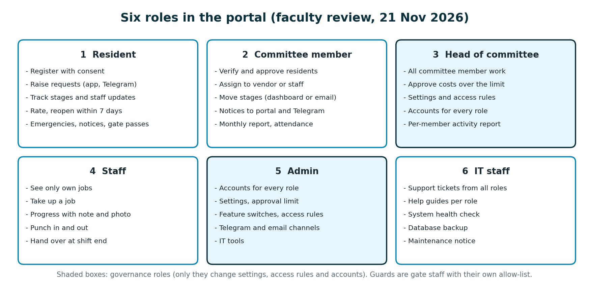

## 2. Process list
| # | Process | Main roles |
| --- | --- | --- |
| 1 | Onboarding and verification | Resident, committee, admin |
| 2 | Raise a request | Resident |
| 3.1 | Allocation | Committee, head |
| 3.2 | Track | Resident, committee |
| 3.3 | Execution | Staff |
| 3.4 | Feedback | Resident |

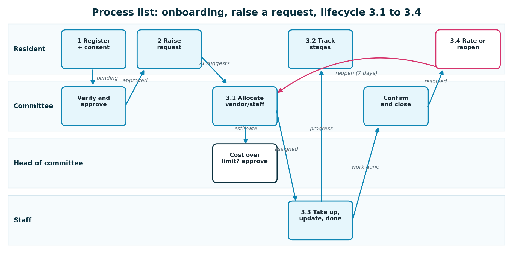

## 3. Stories

### 3.1 Resident
| ID | As a Resident, I want... | so that... | Source |
| --- | --- | --- | --- |
| US-RES-01 | to register with my flat, phone and consent | the committee can verify me | FR-ON-01 |
| US-RES-02 | to know whether I am approved, and why not | I am not left waiting | FR-ON-02 |
| US-RES-03 | as an owner, to add family and tenants | they get access without the committee typing it | FR-ON-04 |
| US-RES-04 | to raise a request with a category, description and photo | the problem is clear first time | FR-WR-01 |
| US-RES-05 | to report a problem by Telegram message | I need not open the portal | FR-WR-13 |
| US-RES-06 | to see my request's stage and who is assigned | I need not phone anyone | FR-WR-02, FR-WR-03 |
| US-RES-07 | to be told when it changes stage | I know when to expect the work | FR-NO-01 |
| US-RES-08 | to rate closed work | good vendors and staff are known | FR-WR-05 |
| US-RES-09 | to raise an emergency in one action or one message | help comes at once | FR-NO-06, FR-NO-07 |
| US-RES-10 | to read notices | I do not miss announcements | FR-NO-02 |
| US-RES-11 | to reopen a request within 7 days | I need not start again | FR-RL-08 |
| US-RES-12 | to book a free amenity slot and cancel it | I can use shared facilities without clashes | FR-SM-02 |
| US-RES-13 | to see my flat's dues, payments and balance | I know what I owe (online payment: planned) | FR-SM-05 |
| US-RES-14 | to see the waste pickup schedule | I put the right bin out on the right day | FR-SM-07 |
| US-RES-15 | to report a missed pickup | it is followed up like any request | FR-SM-09 |
| US-RES-16 | to order groceries from the tuck shop | I need not step out for everyday items | FR-SV-01 |
| US-RES-17 | to book a laundry pickup and follow it | my clothes come back without a phone call | FR-SV-03, FR-SV-04 |
| US-RES-18 | to be told when a parcel arrives at the gate | I collect it the same day | FR-SV-05 |
| US-RES-19 | to see events and say I am going | I do not miss what happens in the society | FR-SV-06 |

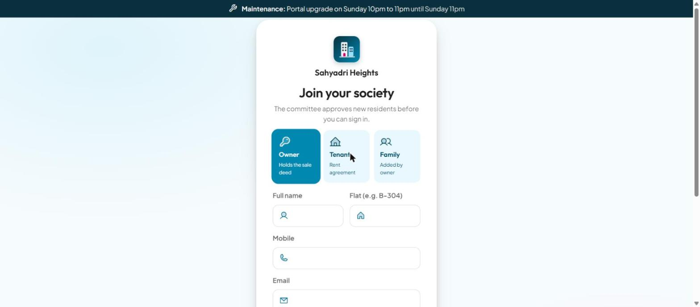

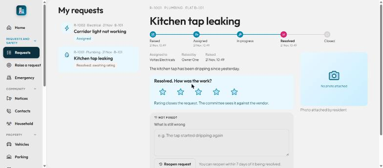

### 3.2 Committee member
| ID | As a Committee Member, I want... | so that... | Source |
| --- | --- | --- | --- |
| US-COM-01 | a dashboard of what needs attention | I act on urgent work first | FR-AD-01 |
| US-COM-02 | to approve or reject new residents | only real residents get access | FR-ON-02, FR-ON-03 |
| US-COM-03 | a suggested vendor or staff member per request | allocation is quick (a person confirms) | FR-WR-08, FR-WR-15 |
| US-COM-04 | to assign a request to a vendor or staff member | someone is accountable | FR-WR-02, FR-RL-04 |
| US-COM-05 | to move requests from the dashboard or email | I can act away from the portal | FR-WR-16 |
| US-COM-06 | overdue requests escalated to me | nothing waits over 48 h unnoticed | FR-WR-10 |
| US-COM-07 | a monthly report, CSV export and weekly digest | I can report to the general body | FR-AD-04, FR-NO-05, FR-RL-09 |
| US-COM-08 | to send notices, with an AI draft | everyone gets the same message | FR-NO-02, FR-NO-04 |
| US-COM-09 | an audit trail of every change | every decision is accountable | FR-AD-03 |
| US-COM-10 | to review messages the AI was unsure about | real problems are not missed | FR-WR-12 |
| US-COM-11 | to set up amenities with hours and slot length | residents can book them | FR-SM-01 |
| US-COM-12 | to raise monthly bills for all or listed flats | dues are tracked per flat | FR-SM-03 |
| US-COM-13 | to record payments, including part payments | balances and overdue flats are correct | FR-SM-04 |
| US-COM-14 | to manage inventory with reorder levels | stock does not run out unnoticed | FR-SM-06 |
| US-COM-15 | to set the weekly waste schedule and see collection totals | pickups and segregation are tracked | FR-SM-07, FR-SM-08 |

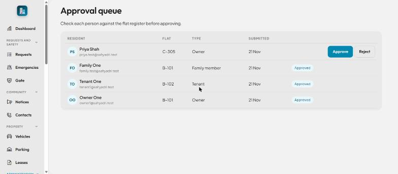

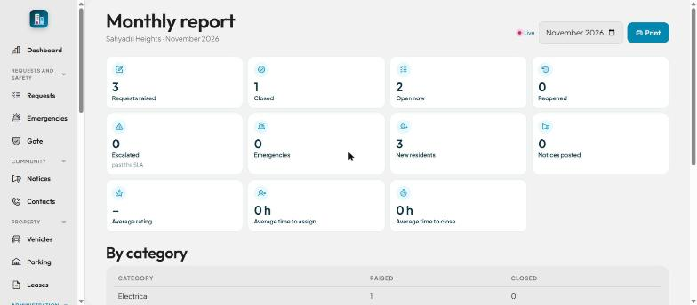

### 3.3 Head of committee
| ID | As the Head of Committee, I want... | so that... | Source |
| --- | --- | --- | --- |
| US-HOC-01 | everything a member has, plus clear extra rights | my role is clear | FR-RL-01 |
| US-HOC-02 | final approval of costs above the limit | spending is controlled | FR-RL-07 |
| US-HOC-03 | per-member activity and performance | I can hold people to account | FR-RL-09 |
| US-HOC-04 | to control access rules and feature flags | no single member changes who can do what | FR-AU-04, FR-AU-05 |
| US-HOC-05 | to hear of every emergency and escalation | I can step in | FR-NO-07, FR-WR-10 |

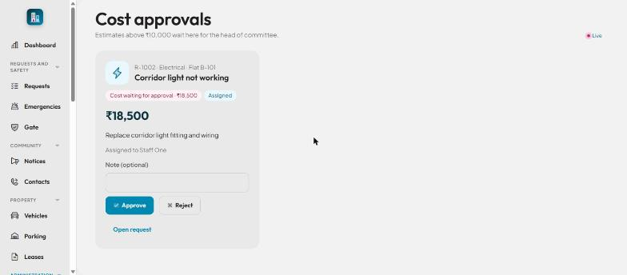

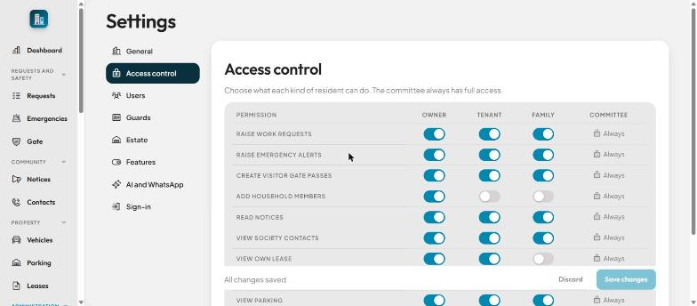

### 3.4 Staff
| ID | As Staff, I want... | so that... | Source |
| --- | --- | --- | --- |
| US-STF-01 | to see only my assigned work | I know what to do today | FR-RL-03 |
| US-STF-02 | to take up a job | the committee knows it started | FR-RL-05 |
| US-STF-03 | to post notes, photos and status | progress is visible | FR-RL-05 |
| US-STF-04 | to punch in and out | attendance needs no paper register | FR-RL-06 |
| US-STF-05 | to hand open jobs to a colleague at shift end | no work is lost | FR-RL-06 |
| US-STF-06 | as a guard, to verify passes and resident tokens | only expected people enter | FR-AD-05, FR-AU-06 |
| US-STF-07 | to record stock I take out | inventory stays correct | FR-SM-06 |
| US-STF-08 | to log waste collections in kg | collection and segregation are tracked | FR-SM-08 |

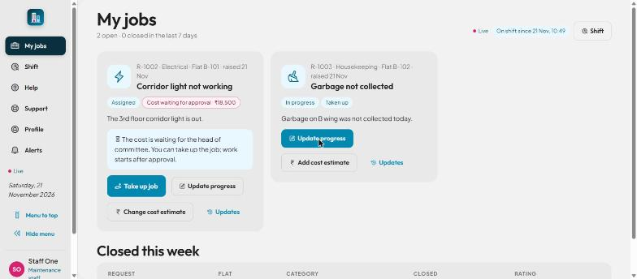

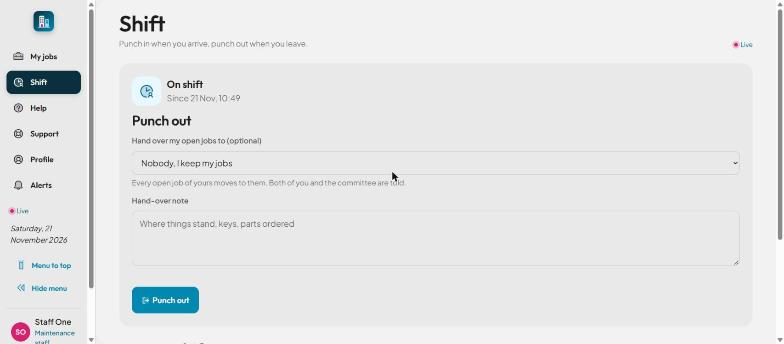

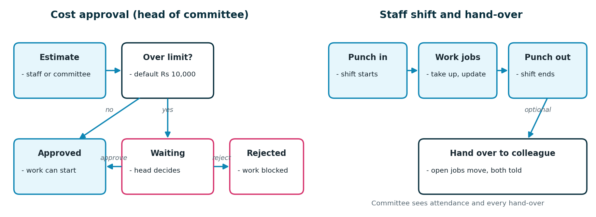

### 3.5 Admin
| ID | As the Admin, I want... | so that... | Source |
| --- | --- | --- | --- |
| US-ADM-01 | to create, suspend and remove accounts and reset passwords | access stays correct | FR-RL-02, FR-AU-07 |
| US-ADM-02 | to set which role can do what | each role sees only what it needs | FR-AU-02, FR-AU-04 |
| US-ADM-03 | to manage master data (vendors, staff, parking, categories) | records are correct. Partly: categories are fixed in code | FR-WR-06, FR-AD-05 |
| US-ADM-04 | to switch features on and off | the society adopts at its own pace | FR-AU-05 |
| US-ADM-05 | to configure Telegram, WhatsApp and the email desk | people are reached where they are | FR-WR-13, FR-WR-16 |

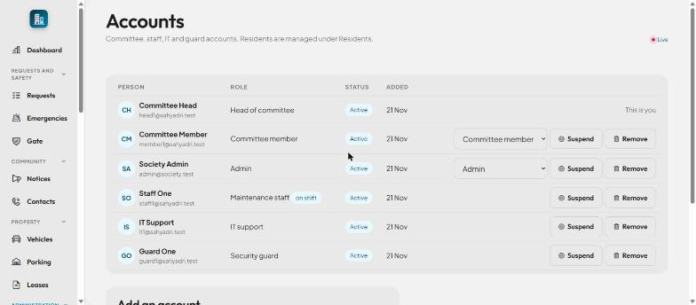

### 3.6 IT staff
| ID | As IT Staff, I want... | so that... | Source |
| --- | --- | --- | --- |
| US-IT-01 | a support queue for portal problems | they are tracked apart from repairs | FR-RL-11 |
| US-IT-02 | guides per role and a demo | people start without help | FR-RL-12 |
| US-IT-03 | backups, a health check and a maintenance notice | no data is lost during upgrades (free hosting still resets) | FR-RL-13, NFR-14 |
| US-IT-04 | a health page | I see problems before users do | FR-RL-13, NFR-04 |
| US-IT-05 | one overview of support queries, training, backups and maintenance | I know what needs me first | FR-RL-14 |

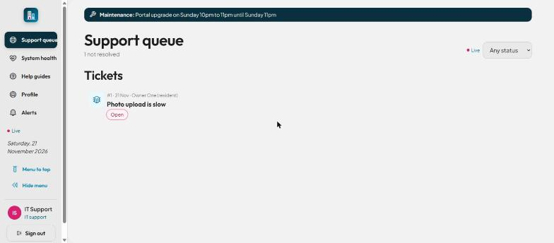

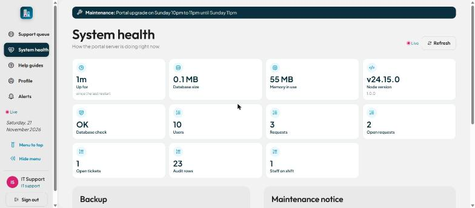

## 4. To confirm with faculty
- "Pre-Journey / Post-Journey" on the whiteboard: as-is and to-be journey maps per role?
- "Punch in / Handover?" is taken as shift attendance and hand-over (US-STF-04, 05).
- Committee item 5 (possibly "Monitor") is taken as the audit trail (US-COM-09).
- Whether outside vendors need a staff login.
